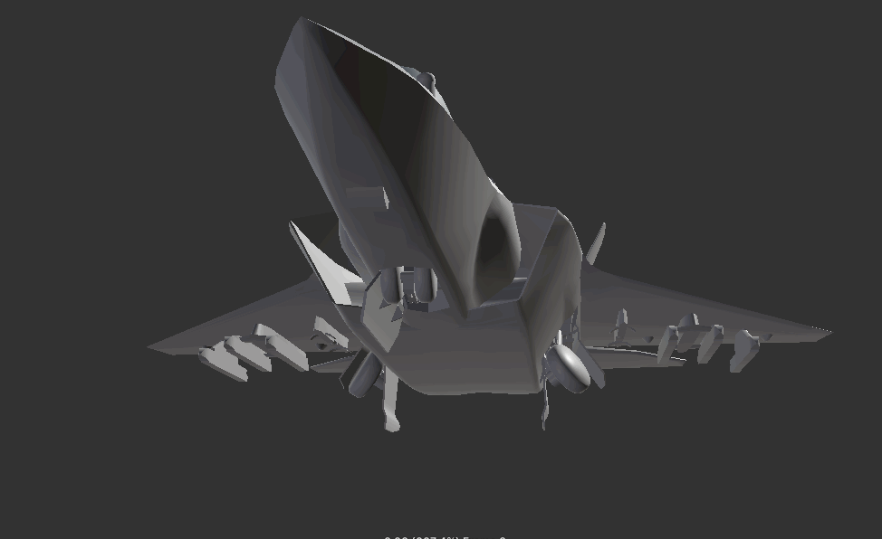
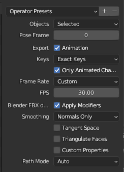
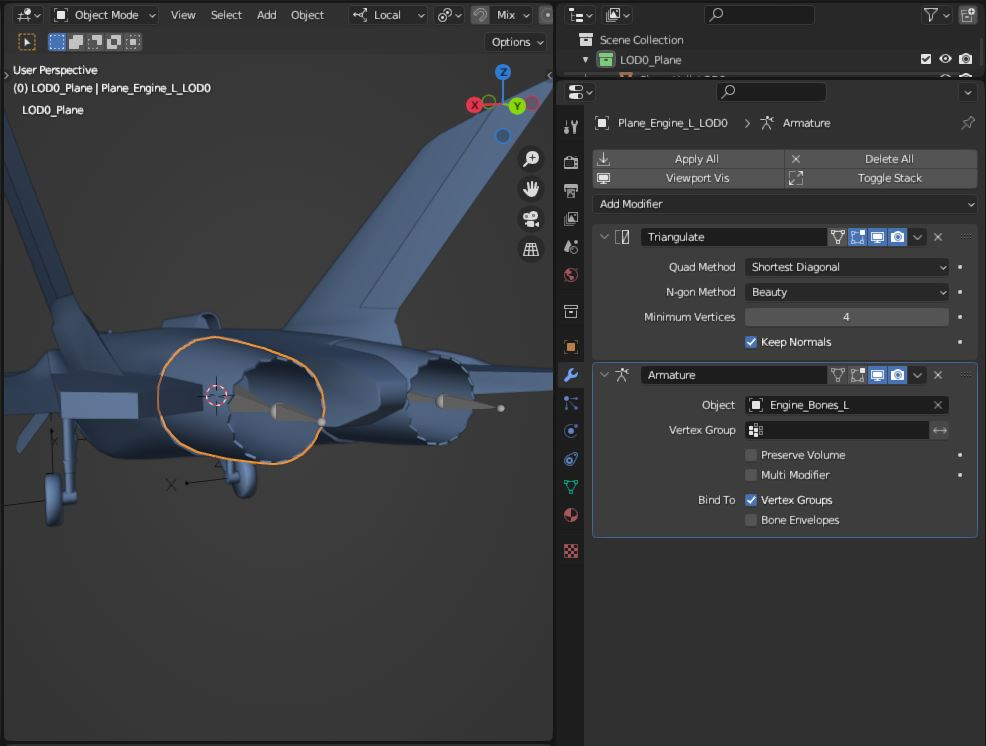
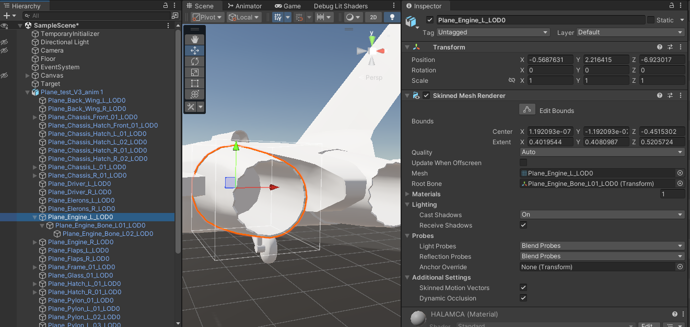
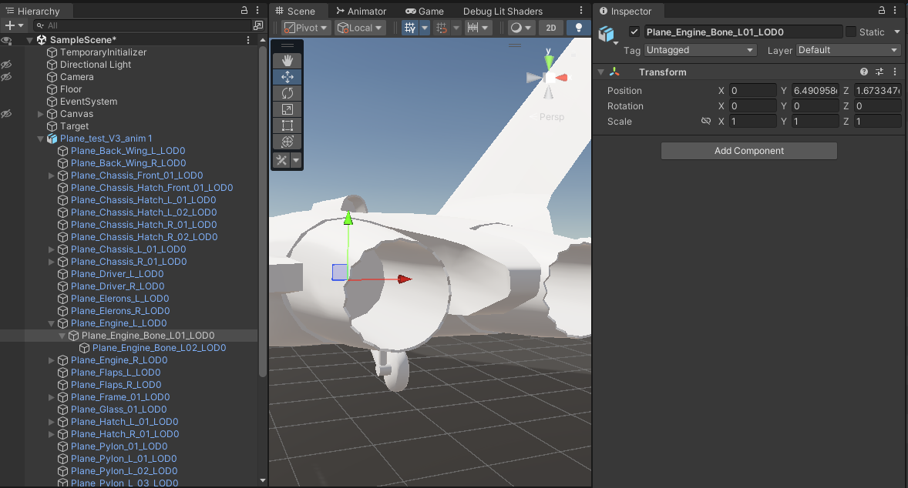
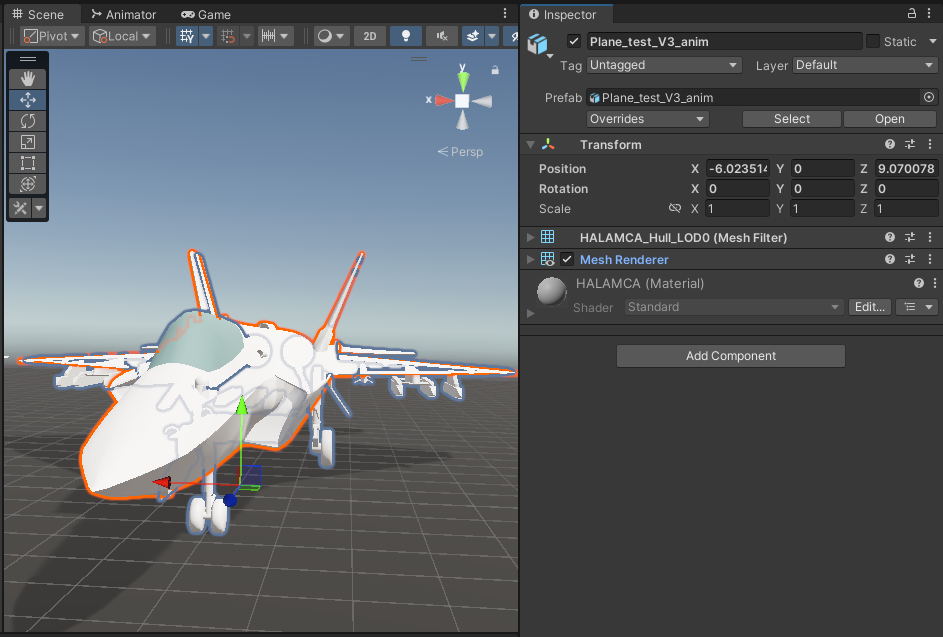

| | |
| :---: | :---: |
| [](images/06_Unity_Anim_preview.gif) | [](images/07_Unity_Anim_preview.gif) |

# FBX Exporter Advanced

A Blender add-on that exports the asset assembly to FBX the propper way. Its first target is **Unity** (Blender → FBX → Unity); other 3D applications that read FBX come second.

It exists because Blender's stock FBX exporter does a poor job on complex assets for Unity, such as long hierarchies with object animation. The scale is off, objects explode, and the keys and axes are wrong: see [Why not Blender's stock FBX exporter](#why-not-blenders-stock-fbx-exporter).

- **Geometry, normals, UVs, colours, materials and textures** are written by Blender's own FBX exporter, unchanged.
- **The assembly is rebuilt the 3ds Max way:**
  - hierarchy and local transforms, with Y-up through a −90° X `PreRotation` on the root nodes;
  - centimetres and Euler rotation orders;
  - keys on Blender's key frames with 3ds Max tangents, or no animation at all;
  - armatures as Null "dummies" (Z forward, Y up) with a Skin deformer and a bind pose.

The animations above were exported from Blender with this add-on and played in Unity: landing gear and hatches (left), and the rear view with the skinned engine nozzles (right).

**Version:** 0.3.1 · **Blender:** 3.6 LTS to 5.2 · **License:** GPL-3.0-or-later

Created by Claude (Anthropic) under the leadership of Kruglov Iurii.

---

## Contents

- [Why not Blender's stock FBX exporter](#why-not-blenders-stock-fbx-exporter)
- [Installation](#installation)
- [Use](#use)
- [Options](#options)
- [Keys](#keys)
- [What is written](#what-is-written)
- [Example: skinned engine nozzles](#example-skinned-engine-nozzles)
- [Differences from 3ds Max's own FBX](#differences-from-3ds-maxs-own-fbx)
- [Verification](#verification)
- [Limitations](#limitations)
- [Changelog](#changelog)
- [License](#license)

---

## Why not Blender's stock FBX exporter

Blender's own FBX exporter (`io_scene_fbx`; its transform code is the same in Blender 3.6 and 5.x) does a poor job on complex assets for Unity, such as long hierarchies with object animation:

- **The scale is off.** With the default settings, root objects get scale 100. The *Apply Transform* option gives them scale 1, but then objects from the third level of a parent chain down (a child of a child) get the wrong size.
- **Objects explode.** With *Apply Transform*, those deeper objects also leave their place in the assembly, by metres.
- **The keys are wrong.** Every frame is re-sampled into XYZ Euler with linear keys and then simplified, so Unity does not get the keys you set, also they are baked every frame in range generating additional keys in all transform channels. With *Apply Transform*, the animation of the deeper objects is wrong as well.
- **The axes are wrong.** The Z-up → Y-up conversion is multiplied into the root objects' rotation, and every rotation is written in XYZ order.

| | Blender's stock exporter | This add-on |
|---|---|---|
| Scale in Unity | **100 on the root objects** (default *Apply Scalings: All Local*) | **1 on every object** |
| *Apply Transform* | Scale 1, but **breaks parent chains** from the third level down. The option is marked experimental and "known to be broken with armatures/animations" (its own tooltip) | Not needed |
| Axes | The Z-up → Y-up conversion is multiplied into the root objects' rotation; every rotation is in XYZ order | A −90° X `PreRotation` on the root nodes; `Lcl Rotation` keeps each object's own values, in its own rotation order |
| Animation | Every frame re-sampled to XYZ Euler, linear keys, then simplified | Blender's keys, with 3ds Max tangents |
| Bones | Armature node, bone-axis correction | Dummies + Skin, with a bind pose |

**Measured** on a chain of six parented boxes with 54 rotation keys, exported by the stock exporter of Blender 4.2 and 5.2:
- **Default settings:** the root box has scale 100. Its rotation is written as (−80.9°, 22.9°, −6.3°) instead of its own (11.5°, 5.7°, 22.9°). The 54 keys become 865.
- ***Apply Transform*:** boxes 1 and 2 are right. Boxes 3 and 4 are 100 times too small, and boxes 5 and 6 are 10,000 times too small. All four are up to 2.2 m out of place. The 54 keys become 1,417.
- ***Apply Transform* with *Apply Scalings: FBX All*:** from box 3 on, sizes change by up to 19% during the animation, and positions are off by up to 1.6 m.
- **This add-on:** every box has scale 1, its own rotation values and Blender's 54 keys, and matches Blender within 0.001 cm.

This add-on keeps Blender's exporter for the data and replaces only the assembly.

---

## Installation

The add-on comes in two forms with the same code inside. Install only one of them. Download it from the [latest release](https://github.com/IuriiKruglov/FBXExporterAdvanced/releases/latest), under *Assets*. The *Source code* archives there are the repository itself, not an add-on Blender can install. Also you can get addon on [Gumroad](https://tricky3d.gumroad.com/l/FbxExporterAdvanced).

| File | Blender | Installs as |
|---|---|---|
| `fbx_exporter_advanced-0.3.1.zip` | 4.2 and later | Extension |
| `fbx_exporter_advanced.py` | 3.6 and later | Legacy add-on |

**Blender 4.2 and later (4.5, 5.x)**
1. Open *Edit → Preferences → Add-ons*.
2. Click the drop-down arrow (⌄) in the top-right corner and choose **Install from Disk…**
3. Select the `.zip` (or the `.py`) and make sure **FBX Exporter Advanced** is enabled.

You can also drag the `.zip` from your file browser into the Blender window.

**Blender 3.6 – 4.1**
1. Open *Edit → Preferences → Add-ons* and click **Install…**
2. Select `fbx_exporter_advanced.py`, then tick the checkbox next to **Import-Export: FBX Exporter Advanced**. Keep the file's name: Blender uses it as the add-on's module name, so a renamed copy installs as a second add-on, and a name with dots in it doesn't load at all.

Blender's own FBX exporter is needed; it is enabled automatically if it was turned off.

**Updating.** Install the new file the same way.
- The extension is replaced in place and stays enabled.
- For the `.py`, turn the add-on off and on again (or restart Blender) so the new code is loaded.
- To switch from the `.py` to the `.zip`, first remove the old add-on: expand it in the Add-ons list and click **Uninstall**.

### Compatibility

| Blender | Status |
|---|---|
| 5.2 LTS | Tested with 5.2.4: exporting, both install forms |
| 4.2 LTS | Tested with 4.2.23: exporting, both install forms |
| 3.6 LTS | Supported with the `.py` file. The code is checked against the Blender 3.6 API and Python 3.10, but no test ran inside 3.6 |

---

## Use

*File → Export → FBX Advanced (.fbx)*. The scene is left exactly as it was.



The status bar reports the result:

```
FBX Advanced: 65 nodes (35 animated), 2 dummies, 1 skins in 0.35 s
FBX Advanced: 65 nodes (no animation), 2 dummies, 1 skins in 0.36 s
```

---

## Options

### Assembly

| Option | Default | Meaning |
|---|---|---|
| **Objects** | All Visible | *All Visible* or *Selected* |
| **Pose Frame** | 0 | Frame of the static pose (the bridge's import frame). Without animation, the assembly is written in this pose |
| **Export Animation** | On | *On*: the animated assembly. *Off*: the same assembly without animation. The file has no keys and no take, and every node holds its pose at *Pose Frame*, with the same values as in the animated file. The three options below apply only with animation (greyed out without it) |
| **Keys** | Exact Keys | **Exact Keys:** keys only on Blender's key frames, with 3ds Max auto tangents, like files exported from 3ds Max after the bridge. See [Keys](#keys). **Bake Every Frame:** one key per frame on every animated node |
| **Only Animated Channels** | On | Channels whose value never changes get no keys. The node keeps their exact static value, so you do not need to delete dead keys in Blender |
| **Frame Rate** | Custom, 30 fps | *Custom*: keep Blender's frame numbers and write this frame rate. 30 fps gives the same timing as the bridge's 3ds Max files: a key on frame 24 is at 0.8 s, so an animation made at 24 fps plays 25% faster than in Blender. *Scene*: Blender's frame rate, the same speed as in Blender |

### Blender FBX data

These are passed to Blender's own exporter, with its defaults: *Apply Modifiers*, *Smoothing*, *Tangent Space*, *Triangulate Faces*, *Custom Properties*, *Path Mode*, *Embed Textures*.

---

## Keys

With **Exact Keys**, translation, rotation and scale each get keys only on the frames where Blender has location, rotation or scale keys:

- **Key values are exact.** Every node matches Blender on its key frames. 3ds Max shows the same key frames, with no extra keys.
- **Between keys**, the curve uses 3ds Max auto tangents, as 3ds Max writes them after the bridge.
- **Bone dummies** take their tangent type from Blender's interpolation, as the bridge sets them: *Constant* → step, *Linear* → linear, flat Bézier handles → flat, anything else → auto.
- **Rotation keys keep Blender's own angle values** when the rotation converts channel for channel (26 of the 28 rotating nodes on the test asset), so a whole turn between two keys survives. Otherwise the angles come from the pose on each key frame, nearest to the previous key.
- **Quaternion and axis-angle rotation** is converted to Euler keys on its key frames.

Some animation cannot be written as keys on Blender's key frames. In those cases, the node (or the whole rig) gets one key per frame, exact on every frame:
- constraints, drivers and NLA strips;
- delta transforms, F-Curve modifiers and linear extrapolation;
- bones that do not inherit rotation or scale.

**Bake Every Frame** writes one linear key per frame on every animated node.

---

## What is written

| Item | Value |
|---|---|
| Axis | Y-up (`UpAxis` 1, `FrontAxis` +2, `CoordAxis` +0, `OriginalUpAxis` 2), as 3ds Max with *Up Axis: Y-up* |
| Units | Centimetres, `UnitScaleFactor` 1 (3ds Max *Units: Automatic* with cm system units) |
| Root nodes | `PreRotation` (−90, 0, 0) and `RotationActive` 1. Position written as (x, z, −y) |
| Other nodes | Local transform relative to the 3ds Max parent, in cm |
| Rotation order | The object's Blender rotation mode (`RotationOrder`, with `RotationActive` 1). Quaternion and axis-angle objects use XYZ. Bone dummies use XYZ, as the bridge creates them |
| Every node | `InheritType` 1, `ScalingMax`, `DefaultAttributeIndex` |
| Hierarchy | As the bridge builds it in 3ds Max (see below) |
| Bones | Every deform bone, its parents and bones carrying objects become a Null node named like the bone, with the bone's axes turned +90° about its X axis (Z forward, Y up) |
| Skin | `Skin` deformer on the mesh, one `Cluster` per deform bone with the weights normalized like Blender's Armature modifier. `TransformLink` = bone dummy in the rest pose, `Transform` = inverse(`TransformLink`) × mesh |
| Bind pose | One `BindPose`, named `BIND_POSES` as 3ds Max names it. It holds the skinned meshes, every bone dummy of their clusters and all their parents. Bone matrices are the clusters' `TransformLink`; meshes and other objects use the pose frame. 3ds Max's importer takes the Skin's initial pose from it, instead of warning that the *Initial Pose* is missing |
| Unweighted vertices | Bound to a `<mesh>__SkinStatic` Null under the mesh |
| Animation | One take, `Take 001`, layer `BaseLayer`. `T` / `R` / `S` curve nodes on `Lcl Translation` / `Lcl Rotation` / `Lcl Scaling`. With *Export Animation* off: no take, no animation stack, layer or curves |
| Geometry, materials | Blender's own exporter, Blender's layout (shared mesh data stays shared) |

**Hierarchy rules.** These follow the bridge:
- An armature object becomes a node only when it is animated.
- Root bones are linked to the armature's parent.
- Objects parented to a bone are linked to that bone's dummy.
- Objects parented to an armature that is not a node are linked to its parent.

---

## Example: skinned engine nozzles

The engine nozzles of the plane in the animations above are skinned. In Blender, each engine mesh has an armature with two bones as its child. The bones carry scale keys, and the mesh deforms through an Armature modifier bound to vertex groups:




In Unity, the armature object is gone with keeping the bones one of which animated, arrive as plain transforms (Blender Empty object, 3ds Max dummies, Unity Game object) under the engine mesh object. The mesh has a *Skinned Mesh Renderer* whose *Root Bone* is the first bone:





The asset's root in Unity has rotation 0 and scale 1:



---

## Differences from 3ds Max's own FBX

Intentional:

- **Static rotation of non-XYZ nodes.** For nodes with a YXZ / ZXY / … rotation order, 3ds Max writes the static `Lcl Rotation` as XYZ angles. A channel without keys then falls back to a wrong value: on the test asset this moves two hatches by 2.35° and the air brakes by 0.67°. This exporter writes the correct value, so deleting keys never changes the orientation.
- **One tangent sign.** One mirrored strut has a wrong rotation slope sign in 3ds Max's file. This exporter writes the correct sign. All other slopes are written exactly as 3ds Max writes them, including its unit for rotation slopes (radians per second, while the values are in degrees).
- **Bind pose.** 3ds Max's file has none, so 3ds Max's own importer warns about the *Initial Pose*. This exporter writes one.
- **Not written** (3ds Max bookkeeping): Physical-material parameters, `MaxHandle`, `UDP3DSMAX`, display layers.

---

## Verification

Test asset: SaabJASGripenE: 60 meshes, 3 empties, 2 skinned bones, 35 animated nodes, YXZ / ZXY rotation orders.

| Check | Result |
|---|---|
| World matrix of every node vs Blender on its key frames (frames 0 – 251) | ≤ 0.000064 cm, ≤ 0.000097° |
| Exact Keys at 30 fps with all channels, vs the file exported from 3ds Max 2024 (FBX 2020.3.2): node properties, parents, every key time / value / flag / slope, skin indexes, weights and matrices | Identical except the two 3ds Max quirks above |
| Keys | 254 keys on 42 curves with *Only Animated Channels*. Without it: 612 keys on 105 curves, as in 3ds Max's file |
| *Export Animation* off | The same file as with animation, minus the take and the animation objects; every node's values are identical. Every node matches Blender's pose at *Pose Frame* (tested at frames 0 and 30; stress scene at frame 25) within 0.00006 cm and 0.00003° |
| Bind pose | Passes the FBX SDK's bind-pose rules: every parent is in the pose, every cluster bone is in the pose with its parents, and bone matrices equal `TransformLink` (difference 0). The independent ufbx reader takes it as the bind pose of every node. Blender's importer gives the same result with and without it |
| Geometry vs 3ds Max's file | Same vertices, polygons, UVs, colours and edges; normals within 0.0009 (Blender 5.2 vs 3.6 weighted normals) |
| Blender 4.2 LTS and 5.2 | Same result. Code checked against Blender 3.6 APIs and Python 3.10 |
| Stress scene: quaternion bones, Euler bones, connected bones, constraints, Cycles modifier, object on a bone, unweighted vertices | Exact at every key frame; baked nodes exact on every frame |

---

## Limitations

- **Between keys**, Exact Keys follows 3ds Max's auto tangents, not Blender's Bézier handles or easing modes. Use *Bake Every Frame* where the in-between motion must match Blender exactly.
- **Cameras and lights** are not exported.
- **Shape key animation** is not exported. Shape keys themselves are written by Blender's exporter.
- **Collection instances** are not converted (you get a warning).
- **Skinning:**
  - only the first Armature modifier of a mesh is converted;
  - envelopes, the vertex-group mask and *Preserve Volume* are ignored (warnings);
  - B-Bone curvature is not converted.
- **Units:** centimetres only.

---

## Changelog

| Version | Changes |
|---|---|
| **0.3.1** | *Frame Rate* defaults to *Custom*, 30 fps, the timing of the bridge's 3ds Max files. First public release, also as a Blender 4.2+ extension |
| **0.3** | *Export Animation* checkbox: the assembly with animation, or the same assembly without animation in the pose of *Pose Frame* |
| **0.2** | Renamed to **FBX Exporter Advanced** (menu: *FBX Advanced (.fbx)*). **Exact Keys** (the former *3ds Max Tangents*) is the default. The *Blender Curves* mode is removed: 3ds Max's importer resampled its curves into extra keys. A bind pose is written for skinned meshes |
| **0.1** | First version, as *FBX Exporter (3ds Max style)*: 3ds Max assembly conventions, Blender curves, 3ds Max tangents and bake modes, only-animated channels, bones as dummies with Skin |

---

## License

GPL-3.0-or-later. See [LICENSE](LICENSE).

Blender is a registered trademark of the Blender Foundation. 3ds Max and FBX are registered trademarks of Autodesk, Inc. Unity is a trademark of Unity Technologies. This project is not affiliated with or endorsed by any of them.
